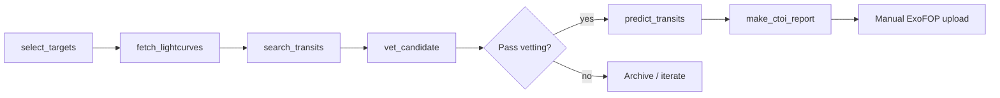

# Skill: End-to-end TESS FFI exoplanet search

Use this procedure with the scripts in `scripts/` to go from target selection through vetting, prediction preregistration, and ExoFOP CTOI preparation. Assumes a Python 3.10+ environment with `pip install -r requirements.txt`.

## Overview



## Step 0 — Environment

```bash
python -m venv .venv && source .venv/bin/activate
pip install -r requirements.txt
```

MAST downloads cache under `data/mast_cache/` by default.

## Step 1 — Pick targets

**Script:** `scripts/select_targets.py`

Nearby dwarfs with TESS coverage, excluding NASA TOI and confirmed-planet hosts. Default: within 60 pc, Tmag < 12, FFI-only (no 2-minute aperture photometry).

```bash
python scripts/select_targets.py -o data/targets.csv --limit 200
```

Inspect `data/targets.csv` (`tic`, `Tmag`, `contratio`, `snr_ref`). Prefer high `snr_ref` and low contamination.

For a single known candidate star:

```bash
echo "tic" > data/one_target.csv
echo "370612437" >> data/one_target.csv
```

## Step 2 — Download light curves

**Script:** `scripts/fetch_lightcurves.py`

Pulls **TESS-SPOC** (NASA) and **QLP** (MIT) FFI products, one best product per sector.

```bash
python scripts/fetch_lightcurves.py 370612437
# → data/lightcurves/370612437.npz
```

Repeat for each `tic` in your target list (batch with a shell loop).

## Step 3 — Search for transits

**Script:** `scripts/search_transits.py`

Biweight detrend (per sector), 10-minute binning, Box Least Squares (BLS). Optional Transit Least Squares: `--tls`.

```bash
python scripts/search_transits.py 370612437 --rho 1.0
# → results/search/370612437_bls.json
# → results/search/370612437_folded.png
```

Record `period_d`, `epoch_btjd`, `depth_ppm`, `duration_d`, `snr`. Ignore SNR < 6 unless inspecting manually.

## Step 4 — Vet the candidate

**Script:** `scripts/vet_candidate.py`

Runs automated checks inspired by community FFI vetting practice:

| Check | Purpose |
|-------|---------|
| catalog | TOI / confirmed planet crossmatch |
| odd_even | blended eclipsing-binary hint |
| secondary | half-period eclipse |
| cross_reduction | SPOC vs QLP depth agreement |
| inverted_lc | search on flipped flux (false-alarm control) |
| holdout_year | hide last sector, blind search + phase verify |
| injection_recovery | synthetic transit recoverability |
| t14_consistency | duration vs stellar density scaling |

```bash
python scripts/vet_candidate.py 370612437 --rho 1.0
# → results/vetting/370612437_vet.md
# → results/vetting/370612437_vet.json
```

Exit code 1 means at least one hard check failed or the star is already a TOI. **Most dips fail here** — that is expected.

Manual follow-ups not in the scripts (recommended by community review):

- Centroid / difference imaging on TESS pixels (nearby eclipsing binary)
- TRICERATOPS or similar statistical FPP
- Gaia neighbor clearing, dilution from companions
- Compare predicted vs measured transit duration (T14) after a full transit fit

## Step 5 — Decide

- **Fail vetting** — document in lab notebook; do not submit to ExoFOP as a new CTOI.
- **Pass vetting** — treat as a *candidate* only; plan ground follow-up via TFOP.

## Step 6 — Preregister predictions

**Script:** `scripts/predict_transits.py`

Emit future midtransit times **before** the next relevant TESS sector.

```bash
python scripts/predict_transits.py 370612437 --months-ahead 24 \
  --period-sigma 2.2e-5 --epoch-sigma 0.001
```

Upload `results/predictions/370612437_predictions.json` to Zenodo; cite the DOI in your ExoFOP note.

## Step 7 — Prepare ExoFOP CTOI fields

**Script:** `scripts/make_ctoi_report.py`

```bash
python scripts/make_ctoi_report.py 370612437 \
  --notes "FFI-only search; vetting report attached."
```

Follow `docs/SUBMITTING_TO_NASA.md` for the live web upload.

## Step 8 — Sanity check on a known planet

Before trusting a new candidate, run the pipeline on a confirmed TOI (e.g. TOI-700 b, TIC 150428135):

```bash
python tests/smoke_test.py
```

Published period should recover within ~1%.

## Reference ephemerides (external)

| Target | TIC | Period (d) |
|--------|-----|------------|
| TOI-700 b | 150428135 | 9.97821 |
| TIC 370612437 candidate | 370612437 | 3.564921 |

## Outputs map

| Path | Content |
|------|---------|
| `data/targets.csv` | Target list |
| `data/lightcurves/<tic>.npz` | Combined FFI arrays |
| `results/search/<tic>_bls.json` | Search ephemeris |
| `results/vetting/<tic>_vet.md` | Human vetting report |
| `results/predictions/<tic>_predictions.json` | Future transits |
| `results/ctoi/<tic>_ctoi_fields.json` | ExoFOP-ready fields |
