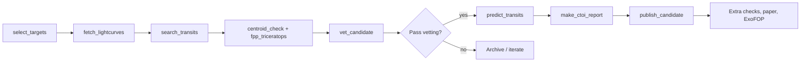

# Skill: End-to-end TESS FFI exoplanet search

Use this procedure with the scripts in `scripts/` to go from target selection through vetting, prediction preregistration, and ExoFOP CTOI preparation. Assumes a Python 3.10+ environment with `pip install -r requirements.txt` (plus `requirements-optional.txt` for exovetter and TRICERATOPS). Everything runs on CPU.

## Overview



## Step 0 — Environment

```bash
python -m venv .venv && source .venv/bin/activate
pip install -r requirements.txt
pip install -r requirements-optional.txt   # optional extras
```

MAST downloads cache under `data/mast_cache/` by default.

## Step 1 — Pick targets

**Script:** `scripts/select_targets.py`

Nearby dwarfs with TESS coverage, excluding NASA TOI and confirmed-planet hosts. Default: within 60 pc, Tmag < 12, FFI-only (no 2-minute aperture photometry).

```bash
python scripts/select_targets.py -o data/targets.csv --limit 200
```

Inspect `data/targets.csv` (`tic`, `Tmag`, `contratio`, `snr_ref`). Prefer high `snr_ref` and low contamination.

For a single known candidate star:

```bash
echo "tic" > data/one_target.csv
echo "370612437" >> data/one_target.csv
```

## Step 2 — Download light curves

**Script:** `scripts/fetch_lightcurves.py`

Pulls **TESS-SPOC** (NASA) and **QLP** (MIT) FFI products, one best product per sector.

```bash
python scripts/fetch_lightcurves.py 370612437
# → data/lightcurves/370612437.npz
```

Repeat for each `tic` in your target list (batch with a shell loop).

## Step 3 — Search for transits

**Script:** `scripts/search_transits.py`

Biweight detrend (per sector, wotan), 10-minute binning, then Box Least Squares (BLS, default, fast) or Transit Least Squares (TLS, limb-darkened template, better for small planets). `--method both` runs both and records a BLS/TLS period cross-check. TLS takes about a minute per star with 8 CPU threads on a multi-year FFI light curve; use BLS for large scans and TLS on the shortlist.

```bash
python scripts/search_transits.py 370612437 --rho 1.0
# → results/search/370612437_bls.json
# → results/search/370612437_folded.png

python scripts/search_transits.py 370612437 --method tls
# → results/search/370612437_tls.json (+ _tls_folded.png)
```

Later steps read the newest of `<tic>_tls.json` / `<tic>_bls.json` unless `--search-json` is given.

Record `period_d`, `epoch_btjd`, `depth_ppm`, `duration_d`, `snr`. Ignore SNR < 6 unless inspecting manually.

## Step 4 — Vet the candidate

**Script:** `scripts/vet_candidate.py`

Runs automated checks inspired by community FFI vetting practice:

| Check | Purpose |
|-------|---------|
| catalog | TOI / confirmed planet crossmatch |
| odd_even | blended eclipsing-binary hint |
| secondary | half-period eclipse |
| cross_reduction | SPOC vs QLP depth agreement |
| inverted_lc | search on flipped flux (false-alarm control) |
| holdout_year | hide last sector, blind search + phase verify |
| injection_recovery | synthetic transit recoverability |
| t14_consistency | duration vs stellar density scaling |
| exovetter | ModShift (Robovetter MS2-style) + SWEET; advisory, feeds the score only |
| centroid | difference-image centroid offset (from `centroid_check.py`) |
| fpp | TRICERATOPS FPP / NFPP (from `fpp_triceratops.py`) |

Pixel-level blend check and false-positive probability (run first, or pass `--run-centroid --run-fpp` to `vet_candidate.py`):

```bash
python scripts/centroid_check.py 370612437 --max-sectors 4
# → results/centroid/370612437_centroid.json, _diff_image.png
python scripts/fpp_triceratops.py 370612437 --repeats 5
# → results/fpp/370612437_fpp.json  (writes "skipped" if triceratops/MAST unavailable)
```

The centroid check fails if the difference-image centroid is offset by more than 1 pixel (21") at more than 3 sigma. It also lists TIC stars bright enough to produce the depth if fully eclipsed. TRICERATOPS guidance (Giacalone et al. 2021): FPP < 0.015 and NFPP < 0.001 → statistically validated level; FPP < 0.5 → likely planet; the check fails otherwise.

```bash
python scripts/vet_candidate.py 370612437 --rho 1.0
# → results/vetting/370612437_vet.md
# → results/vetting/370612437_vet.json
```

Exit code 1 means at least one hard check failed or the star is already a TOI. **Most dips fail here** — that is expected.

The report includes a **ranking score** (0–1, `exoplanet_hunter/scoring.py`): a hand-weighted logistic combination of SNR, odd/even, secondary, duration, inverted-LC, holdout, injection, cross-reduction, centroid, FPP and ModShift results. Use it to order candidates for manual review; it is not a probability that the signal is a planet.

Manual follow-ups not in the scripts (recommended by community review):

- Inspect the difference image and neighbour list by eye; check Gaia for unresolved companions
- Add high-resolution imaging contrast curves to TRICERATOPS (`contrast_curve_file`) when available
- Compare predicted vs measured transit duration (T14) after a full transit fit

## Step 5 — Decide

- **Fail vetting** — document in lab notebook; do not submit to ExoFOP as a new CTOI.
- **Pass vetting** — treat as a *candidate* only; plan ground follow-up via TFOP.

## Step 6 — Preregister predictions

**Script:** `scripts/predict_transits.py`

Emit future midtransit times **before** the next relevant TESS sector.

```bash
python scripts/predict_transits.py 370612437 --months-ahead 24 \
  --period-sigma 2.2e-5 --epoch-sigma 0.001
```

Upload `results/predictions/370612437_predictions.json` to Zenodo; cite the DOI in your ExoFOP note.

## Step 7 — Prepare ExoFOP CTOI fields

**Script:** `scripts/make_ctoi_report.py`

```bash
python scripts/make_ctoi_report.py 370612437 \
  --notes "FFI-only search; vetting report attached."
```

This writes a parameter table only. It does not upload anything. Current ExoFOP policy requires a refereed paper (or an RNAAS that cites a published methods paper) and prior approval before a community candidate can be added — see `docs/SUBMITTING_TO_NASA.md`.

## Step 8 — Package the candidate in this repo

**Script:** `scripts/publish_candidate.py`

After vetting passes, copy the search, vetting, prediction, and CTOI outputs into `candidates/TIC<id>/`, write a summary README, and append a row to `candidates/INDEX.md`:

```bash
python scripts/publish_candidate.py 370612437
# after review, commit and push the folder:
python scripts/publish_candidate.py 370612437 --git-commit --git-push
```

The script exits without writing if `overall_pass` is false, unless you pass `--force`. Status starts as “Community candidate, unconfirmed.” Nothing in `candidates/` is a confirmed planet. Official names are not assigned here; see `docs/NAMING.md`.

Then follow the checklist in `docs/SUBMITTING_TO_NASA.md`: extra blend / FPP / catalog checks, Zenodo preregistration, the paper, an ExoFOP account, the Published Candidate Upload Request, and the web upload.

## Step 9 — Sanity check on a known planet

Before trusting a new candidate, run the pipeline on a confirmed TOI (e.g. TOI-700 b, TIC 150428135):

```bash
python tests/smoke_test.py
```

Published period should recover within ~1%.

## Reference ephemerides (external)

| Target | TIC | Period (d) |
|--------|-----|------------|
| TOI-700 b | 150428135 | 9.97821 |
| TIC 370612437 candidate | 370612437 | 3.564921 |

## Outputs map

| Path | Content |
|------|---------|
| `data/targets.csv` | Target list |
| `data/lightcurves/<tic>.npz` | Combined FFI arrays |
| `results/search/<tic>_bls.json` / `_tls.json` | Search ephemeris (BLS / TLS) |
| `results/centroid/<tic>_centroid.json` | Difference-image centroid offset, neighbours |
| `results/fpp/<tic>_fpp.json` | TRICERATOPS FPP / NFPP |
| `results/vetting/<tic>_vet.md` | Human vetting report + ranking score |
| `results/predictions/<tic>_predictions.json` | Future transits |
| `results/ctoi/<tic>_ctoi_fields.json` | ExoFOP-ready fields |
| `candidates/TIC<tic>/` | Packaged public candidate (README, plots, JSON, CTOI text) |
| `candidates/INDEX.md` | Table of packaged candidates and their status |
